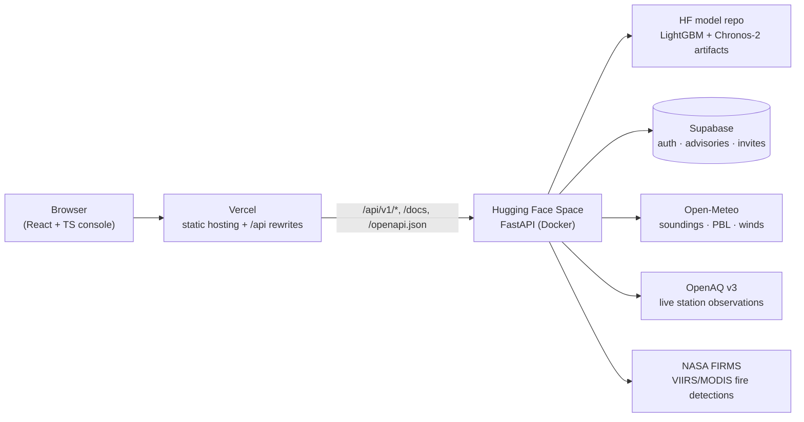

# AirLens — Delhi NCR Coupled AQI Forecast


<!-- PROBLEM STATEMENT ID: fill in -->
<!-- Problem statement title: fill in -->

**Team Tech Titans (TECHTITANS07X).** Aditya Selvaraj, Aswitha — Delhi Technological University cluster.

<!-- Live web URL: fill in -->
<!-- Live API / docs URL: fill in -->
<!-- Demo video URL: fill in -->

AirLens couples a **physics-based single-column atmospheric engine** with a **fleet of per-station
LightGBM forecasters** (and a Chronos-2 LoRA comparison model) to produce 7-day (168-hour) air-quality
forecasts for Delhi NCR. The engine models how thermal inversions and boundary-layer dynamics trap
pollution, how aerosols dim surface radiation and feed back on the boundary layer, and how stubble-fire
plumes advect toward the city — then serves it all behind a real-time, trilingual dashboard with
authority advisories, exposure tracking and alerts.

## Features

- **168-hour per-station forecasts** — per-station LightGBM models for PM2.5, PM10, NO2, O3, SO2 across 45 CPCB stations (`GET /api/v1/forecast/station-168hr`), with conformal-style uncertainty bands; a fine-tuned **Chronos-2 LoRA** comparison model is available behind the `ENABLE_CHRONOS` flag.
- **Physics engine** (`backend/app/physics/`) — thermal-inversion engine (ΔT, lapse rate, PBL suppression), a **prognostic two-reservoir column box model** (mixed + residual layer with an explicit mass budget), and FIRMS-driven **plume advection** with hourly 850 hPa trajectories; the 72-hour city forecast (`GET /api/v1/forecast/72hr`) closes the two-way PM2.5 → AOD → shortwave → surface-cooling → boundary-layer loop by Picard iteration.
- **CPCB 2014 AQI** sub-indices for all six criteria pollutants, with US-EPA breakpoints + NowCast for the live station panel; AQI is always `max(sub-indices)`.
- **FIRMS stubble tracking** — fire radiative power → emission chain → direction-aware dose at Delhi, plus a no-smoke counterfactual for attribution (`GET /api/v1/plume/vectors`).
- **Authority console** — Supabase auth, advisories, an AI health assistant (Groq, with graceful degradation when unset) and text-to-speech; a model-transparency endpoint shows live observation vs forecast vs reference side by side.
- **Hindi / Tamil / English UI** — the entire console is translated.
- **Alerts & exposure tracker** — cumulative-dose exposure windows (`GET /api/v1/exposure/calculate`), source apportionment, industrial-catalog lookups and an IITM SAFAR reference feed.

## Architecture

Current deployment: **frontend on Vercel, ML inference API on Hugging Face Spaces, database on Supabase.**
The production target is **AWS** — the backend is Docker-packaged and portable to ECS or App Runner,
with models in S3 and the database on Supabase or RDS (nothing is deployed on AWS in this submission).



The backend also serves the built console same-origin at `/console` when run directly
(`docker-compose` or local uvicorn), which is how development works without Vercel.

## Model evaluation (holdout, measured)

All numbers below are read from committed evaluation artifacts — nothing here is hand-computed or
projected. Sources: `llm/model/station_models/metrics_summary.json`,
`llm/model/station_models_chronos2/metrics_summary.json`, `llm/model/station_models_chronos2/CHRONOS2_VERDICT.md`.

**LightGBM fleet** — per-station, per-pollutant models on a **120-day holdout window
(2026-05-19 → 2026-09-16)**, scored on the stations' own merged hourly frames under the deployed-model
protocol. Medians across the 45 stations (38 for SO2), concentrations in µg/m³:

| Pollutant | Holdout MAE (median) | RMSE (median) | R² (median) | 1–6 h MAE (median) |
|---|---|---|---|---|
| PM2.5 | 17.6 | 23.0 | 0.11 | 15.0 |
| PM10  | 48.7 | 74.7 | 0.30 | 42.1 |
| NO2   | 9.1  | 23.0 | 0.29 | 7.3 |
| O3    | 11.0 | 13.8 | 0.34 | 9.2 |
| SO2   | 3.9  | 15.5 | 0.05 | 3.1 |

Per-station values (MAE ranges roughly 10.9–44.8 for PM2.5) and earlier rolling-origin folds —
including a dedicated Oct–Nov 2025 stubble-season fold — are in the same file.

**Chronos-2 (LoRA fine-tune)** — evaluated as a candidate replacement on 33 (station, pollutant) pairs
under the same aligned holdout protocol. In the head-to-head on identical (t0, horizon) pairs, the
production LightGBM fleet won every evaluated slice, so **zero pairs were promoted** to Chronos-2 and
it ships as an optional comparison path (`ENABLE_CHRONOS=1`), not the default. The full win/loss tables
are in `CHRONOS2_VERDICT.md`.

**Physics engine** — validated behaviourally (unit suite in `backend/tests/`, scripts in
`scripts/verify/`), **not backtested against withheld historical observations**. The correct answer to
"what is the physics engine's MAE?" is "we have not measured it"; see
[docs/KNOWN_LIMITATIONS.md](docs/KNOWN_LIMITATIONS.md) for the full scope statement.

## Quickstart

### Local development (no Docker)

```bash
git clone https://github.com/TECHTITANS07X/AIRLENS.git airlens
cd airlens
python -m venv .venv
source .venv/bin/activate        # Windows: .venv\Scripts\activate
pip install -r requirements.txt
cp .env.example .env             # then fill in the keys you have

# Terminal 1 — backend (serves the API on :8000)
uvicorn app.main:app --app-dir backend --reload --port 8000

# Terminal 2 — webapp (hot reload; proxies /api -> :8000)
cd webapp && npm ci && npm run dev    # http://localhost:5173/console/
```

Open http://localhost:8000/docs for Swagger, http://localhost:8000/api/v1/health for the health check.
The forecast and inversion endpoints work with no API keys (Open-Meteo needs none); live stations need
`OPENAQ_API_KEY`, fires need `FIRMS_API_KEY`, and the code degrades honestly rather than inventing
data when a key is missing.

### Docker

```bash
cp .env.example .env    # fill in keys
docker-compose up --build
```

Brings up the backend (the React console is built into the image by a Node stage and served
same-origin at `/console`) and Redis on a single host.

```bash
docker-compose down
```

## Environment variables

| Variable | Required | Purpose |
|---|---|---|
| `APP_API_KEY` | Yes | Key for mutating endpoints (X-API-Key). Ingestion returns 503 while unset or placeholder |
| `ALLOWED_ORIGINS` | Yes | Comma-separated CORS origins (your Vercel domain — not `*`) |
| `OPENAQ_API_KEY` | For live stations | `/realtime/*` returns 502 without it |
| `FIRMS_API_KEY` | For plume features | Hotspot list is empty without it — never synthetic |
| `GROQ_API_KEY` | For AI assistant | `/health/chat` returns 503 with a clear message when unset |
| `SUPABASE_URL` | For auth/advisories | Supabase project URL |
| `SUPABASE_SERVICE_ROLE_KEY` | Server-side only | Never shipped to the browser; RLS must be enabled on all tables |
| `MODEL_SOURCE` | No | `local` (default) or `hf` — where station models load from |
| `HF_MODEL_REPO` | For `MODEL_SOURCE=hf` | e.g. `techtitans07x/airlens-models` |
| `HF_TOKEN` | For private model repos | Read token for the HF model repo |
| `MODEL_CACHE_DIR` | No | Download cache for HF mode (defaults to a temp dir) |
| `ENABLE_CHRONOS` | No | `1` enables the Chronos-2 comparison path (CPU-only Spaces: leave `0`) |

See [.env.example](.env.example) for the full list with placeholders.

## Project structure

```
backend/app/                FastAPI service
  api/v1/                   endpoints, auth, ML forecast routes
  core/                     settings, security (API key, CSP, rate limits)
  physics/                  inversion_engine, box_model, plume_advection
  services/                 aqi_service, realtime_service, exposure, industry, supabase, ...
  domain/                   pure AQI-scale + species arithmetic (no third-party imports)
  schemas/                  Pydantic I/O models
llm/model/                  per-station forecasting module
  station_models/           LightGBM artifacts (one dir per station) + metrics_summary.json
  station_models_chronos2/  Chronos-2 LoRA artifacts + eval files + CHRONOS2_VERDICT.md
  station_forecast_*.py     serving endpoint + service
llm/artifacts/              station_registry.json
llm/model/training/         training pipeline (features, train_all, HPO, fire features)
webapp/                     React + TypeScript console (Vite, Tailwind, Leaflet, Recharts; i18n)
docs/                       ARCHITECTURE, API, DEPLOYMENT, KNOWN_LIMITATIONS, guides
scripts/                    verify/ (physics checks), manual/ (live smoke), deploy/
supabase/                   schema / setup
api/                        Vercel functions (tts.js)
Dockerfile.backend          multi-stage: Node builds webapp → python:3.11-slim serves it
docker-compose.yml          backend + redis
vercel.json                 frontend hosting + /api rewrites
```

## Verification

```bash
python backend/tests/run_without_pytest.py   # 176 tests, stdlib runner (or: pytest backend/tests)
python scripts/verify/calib.py               # seasonal box-model behaviour, Aug vs Nov
python scripts/verify/attrib.py              # feedback strength with and without smoke
python scripts/verify/plumecheck.py          # plume emissions, geometry, direction-awareness
python scripts/verify/windcheck.py           # wind convention and trajectory direction
```

The station-model holdout numbers above are reproducible from the committed metrics files; the
evaluation protocol is documented alongside them. The physics engine is pinned by invariant-based unit
tests, not by accuracy figures — no withheld-data backtest exists for it yet
([docs/KNOWN_LIMITATIONS.md](docs/KNOWN_LIMITATIONS.md)).

## Deployment

Step-by-step deployment (model upload to the HF Hub, Hugging Face Space creation and secrets, Vercel
setup, smoke tests) is in [docs/DEPLOYMENT.md](docs/DEPLOYMENT.md).

## Documentation

- [docs/ARCHITECTURE.md](docs/ARCHITECTURE.md) — physics, coupling loop, data flow, scope limits
- [docs/API.md](docs/API.md) — REST endpoint reference with cURL examples
- [docs/DEPLOYMENT.md](docs/DEPLOYMENT.md) — Vercel + HF Spaces + Supabase topology and runbook
- [docs/KNOWN_LIMITATIONS.md](docs/KNOWN_LIMITATIONS.md) — explicit scope limits of the current build
- [SECURITY.md](SECURITY.md) — threat model and deployment hardening

## License

Released under the [MIT License](LICENSE).
